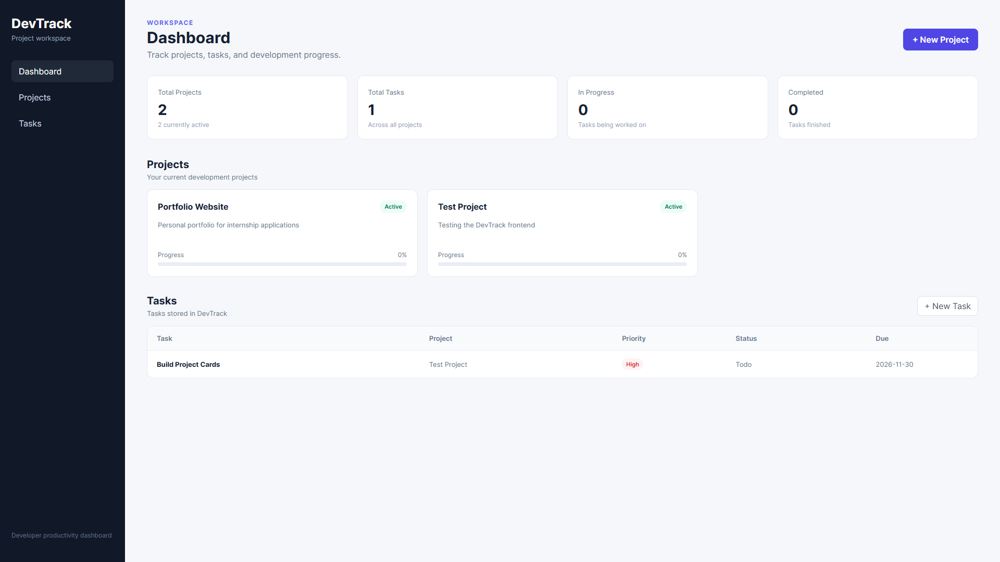

# DevTrack

DevTrack is a full-stack project and task management application for tracking development work, deadlines, priorities, and project progress.

It uses a React dashboard connected to a Spring Boot REST API with PostgreSQL persistence.

## Demo



## Features

- Create and view projects
- Create tasks and assign them to projects
- Track task status, priority, and due dates
- Calculate project progress from completed tasks
- Dashboard statistics for projects and tasks
- Full CRUD REST API for projects and tasks
- PostgreSQL data persistence
- Server-side input validation
- Automated backend API tests
- Responsive React dashboard

## Tech Stack

### Frontend

- React
- Vite
- JavaScript
- CSS

### Backend

- Java 21
- Spring Boot
- Spring Web
- Spring Data JPA
- Hibernate
- Jakarta Validation

### Database

- PostgreSQL
- H2 for automated tests

## Architecture

```text
React Frontend
      |
      | HTTP / JSON
      v
Spring Boot REST API
      |
      | JPA / Hibernate
      v
PostgreSQL
```

## API Endpoints

### Projects

| Method | Endpoint | Description |
| --- | --- | --- |
| GET | `/api/projects` | List projects |
| GET | `/api/projects/{id}` | Get a project |
| POST | `/api/projects` | Create a project |
| PUT | `/api/projects/{id}` | Update a project |
| DELETE | `/api/projects/{id}` | Delete a project |

### Tasks

| Method | Endpoint | Description |
| --- | --- | --- |
| GET | `/api/tasks` | List tasks |
| GET | `/api/tasks/project/{projectId}` | List tasks for a project |
| POST | `/api/tasks` | Create a task |
| PUT | `/api/tasks/{id}` | Update a task |
| DELETE | `/api/tasks/{id}` | Delete a task |

## Running DevTrack Locally

### Requirements

- Java 21
- PostgreSQL
- Node.js and npm

### 1. Create the database

Create a PostgreSQL database named `devtrack`.

### 2. Start the backend

From the `backend` directory, set your PostgreSQL password:

```powershell
$env:DB_PASSWORD="YOUR_POSTGRES_PASSWORD"
```

Then run:

```powershell
.\mvnw.cmd spring-boot:run
```

The backend runs at `http://localhost:8080`.

### 3. Start the frontend

From the `frontend` directory:

```powershell
npm.cmd install
npm.cmd run dev
```

The frontend runs at `http://localhost:5173`.

## Testing

Backend tests use an in-memory H2 database, so they do not modify the PostgreSQL development database.

Run:

```powershell
cd backend
.\mvnw.cmd test
```

The test suite checks application startup, valid project creation, and rejection of invalid project and task requests.

## Project Structure

```text
DevTrack/
|-- backend/
|   `-- src/
|       |-- main/
|       `-- test/
|-- frontend/
|   `-- src/
|       |-- App.jsx
|       |-- App.css
|       `-- main.jsx
`-- README.md
```

## Author

Hetank Patel  
Computer Science student at the University of Saskatchewan